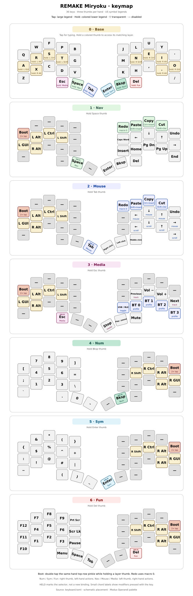

# REMAKE Miryoku

A ready-to-build, portable [Miryoku](https://github.com/manna-harbour/miryoku)
firmware sample for the 36-key
[REMAKE keyboard](https://github.com/6mil-labs/remake), with nice!nano v2
controllers, a BLE split link, USB/BLE host connections, and nice!view screens.

Firmware and host tests both use **released RMK 0.9.0 from crates.io**.
There are no Git dependencies or local source overrides. `keyboard.toml` is
the complete keymap; `vial.json` exposes all 36 physical keys for remapping.

## Layout

This sample uses Miryoku's default **Colemak Mod-DH** alphas and seven layers.
The central screen displays the matching layer names.



```text
Q       W       F       P       B       J       L       U       Y       '
A/GUI   R/Alt   S/Ctrl  T/Shift G       M       N/Shift E/Ctrl  I/Alt   O/GUI
Z       X/AltGr C       D       V       K       H       ,       ./AltGr /
```

The home-row modifiers are mirrored between hands. AltGr uses right Alt.
Symbol bindings assume a **US host keyboard layout**.

Each thumb taps a key and holds a layer. From left to right:

| Position | Tap | Hold |
|---|---|---|
| Left third `(3,2)` | Escape | Media (3) |
| Left home `(3,3)` | Space | Nav (1) |
| Left inner `(3,4)` | Tab | Mouse (2) |
| Right inner `(3,5)` | Enter | Sym (5) |
| Right home `(3,6)` | Backspace | Num (4) |
| Right third `(3,7)` | Delete | Fun (6) |

Layers put ordinary modifiers on the holding hand and their main actions
on the opposite hand:

| Layer | Opposite-hand actions |
|---|---|
| Base (0) | Colemak Mod-DH alphas and dual-function keys |
| Nav (1) | Clipboard; Left/Down/Up/Right; Home/Page Down/Page Up/End; Caps Word and Insert; Enter/Backspace/Delete thumbs |
| Mouse (2) | Clipboard; mouse movement and scrolling; right/left/middle mouse-button thumbs |
| Media (3) | Previous track/volume down/volume up/next track; stop/play-pause/mute thumbs; Bluetooth and output controls |
| Num (4) | Numpad-shaped 7–9, 4–6, 1–3; brackets and punctuation; Dot/0/Minus thumbs |
| Sym (5) | Explicit shifted symbols in Num's positions; `(`/`)`/`_` thumbs |
| Fun (6) | F1–F12, Print Screen, Scroll Lock and Pause; Application/Space/Tab thumbs |

Clipboard follows Miryoku's default CUA bindings: Shift+Delete cuts,
Ctrl+Insert copies, and Shift+Insert pastes. Undo/redo use HID Undo/Again,
which may need application bindings. Caps Word is the inner-index key on Nav.
Redo uses macro 0 to emit raw HID Again; RMK's normal `Again` action would
repeat the previous key instead.

On any sublayer, **double-tap the same-hand top-row pinkie while holding the
layer thumb** to enter the central controller's bootloader. A single tap or
hold does nothing; the double-tap gap is 200 ms. Use the peripheral controller's
physical bootloader/reset procedure to flash that half.

### Portable adaptation

This is not a full QMK/ZMK feature-parity port:

- **No Auto Shift**: use Shift or Sym for shifted symbols.
- **No fork-only buffered tap/hold**. Home-row modifiers use RMK's 200 ms
  permissive hold with same-hand filtering. Thumbs use 200 ms hold-on-other-press
  without hand filtering. Flow-tap and quick-tap repeat are disabled.
- No tri-layer or thumb combos. Each thumb accesses its own layer.
- No layer locks, Extra/Tap alternate base layers, or separate Button layer.
- No RGB or manual external-power controls; screen power follows sleep/wake.

Hold a layer thumb through its tapping term before pressing another dual-function
key if an early chord is ambiguous. Tune `[behavior.morse]` for your typing style.

The key positions follow the
[Miryoku reference](https://github.com/manna-harbour/miryoku/tree/master/docs/reference)
and [Miryoku Babel](https://github.com/manna-harbour/miryoku_babel/tree/64791c9f895e9b49809e36420ebbf1b8573288cc)
by manna-harbour. The sample adds REMAKE's Bluetooth controls where RGB controls
would otherwise be unused.

## Bluetooth, displays and power

Hold Escape for Media. On the right half:

- Bottom row, inner to outer: output toggle, profiles 0, 1, 2, 3.
- Top row, columns 6–9: profiles 4, 5, next profile, previous profile.
- Hold a profile key for five seconds to forget that profile's bond and re-pair.

Each screen uses a compact dark layout with a battery icon and numeric
percentage, or `?` and `--%` when unknown. The bolt indicates local USB power,
not charging. The central shows the prominent uppercase layer and a compact
zero-based profile (`P0`, `P1`, etc.). Its static host icon distinguishes connected
(plain Bluetooth symbol), advertising (small squares and short arcs on both sides),
and disconnected (an X). The peripheral shows `OK` or `WAIT` for its split link.

Status fields have fixed bounds. Ordinary changes update only affected physical
rows; startup, wake, and recovery still redraw the full screen. Unchanged content
uses hold commands at the same 16 ms panel cadence, without advertising animation.

After 30 seconds idle, split-link subrating reduces radio activity and the
screens clear and switch off their supply. They reinitialize and redraw on
wake. This is not MCU System OFF; peripheral wake can have extra link latency.
USB CDC logging is disabled; add `usb_log` to RMK's features to enable it.

## Build and flash

Run from the repository root:

```sh
cargo install cargo-make             # once
cargo make test
cargo make uf2 --release
```

Put each controller into its UF2 bootloader and copy the matching image:

- `remake-miryoku-central.uf2` — left/central half.
- `remake-miryoku-peripheral.uf2` — right/peripheral half.

Flash matching builds to both halves. Switching RMK versions or Cargo features
can clear stored settings and bonds, requiring host and split re-pairing.
Back up custom Vial mappings before resetting a stored keymap to load these defaults.

## Hardware mapping and tests

The sample retains REMAKE's 4 × 5 scan matrix per half, `col2row` diodes,
and three thumbs at physical row 3, columns 2/3/4 (SW18/SW16/SW17).
The right scan columns are reversed for the flipped controller. D18 uses
**P1.15**, as shown in the
[nice!nano v2 pinout](https://nicekeyboards.com/docs/nice-nano/pinout-schematic).
GPIO assignments are recorded in `keyboard.toml`.

Without cargo-make:

```sh
cargo test --manifest-path tests/host/Cargo.toml \
  --target "$(rustc -vV | sed -n 's/^host: //p')" --locked
cargo build --release --bins --locked
```

Native tests cover the real seven-layer configuration, all six thumb taps/holds,
mirrored home-row modifiers, keyboard/mouse/media reports, matrix routing,
layer labels, 5 ms debounce, display rendering, SPI recovery/cancellation, and sleep.
On hardware, check all switches, typing/chords, mouse/media actions, Bluetooth
profiles, and wake on both halves. Native tests do not validate electrical
continuity, physical timing, or radio behavior.
